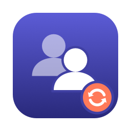
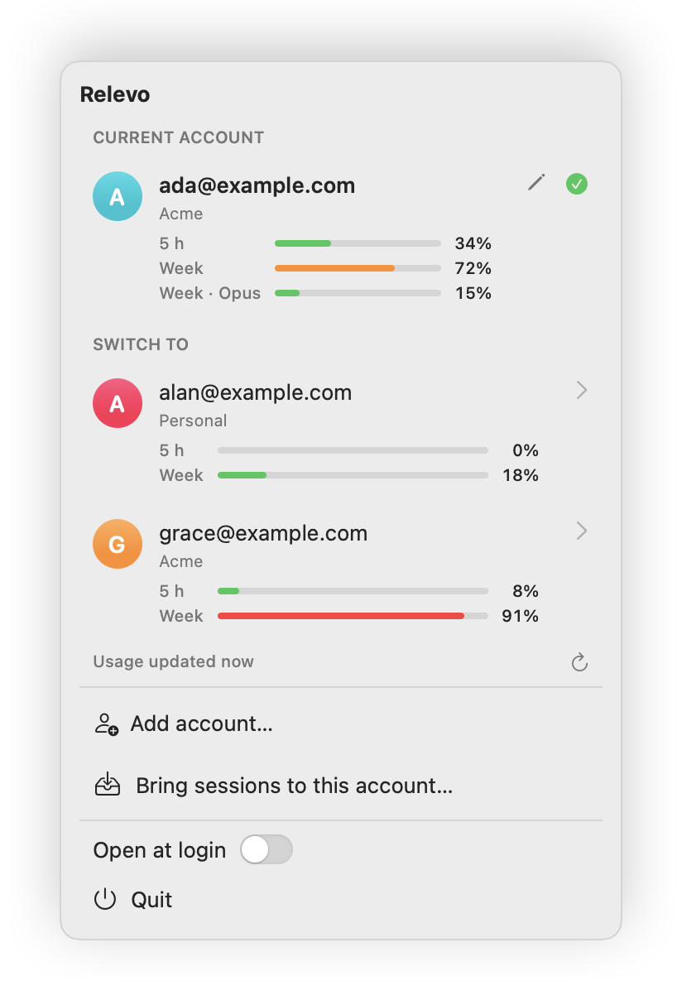
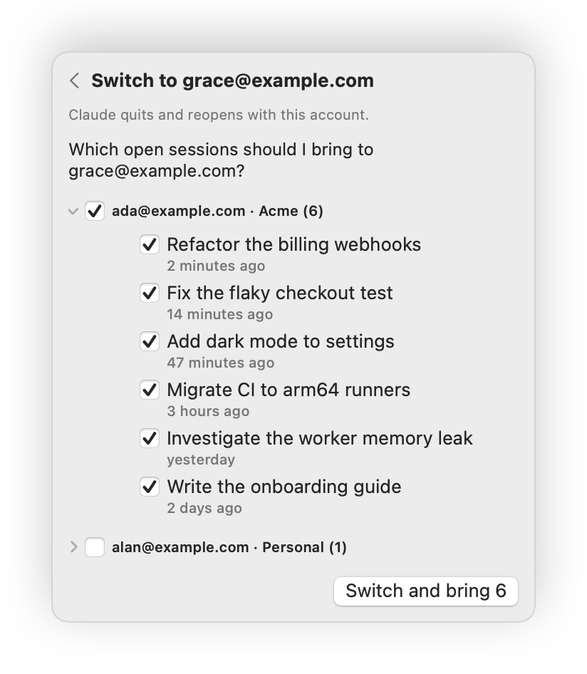
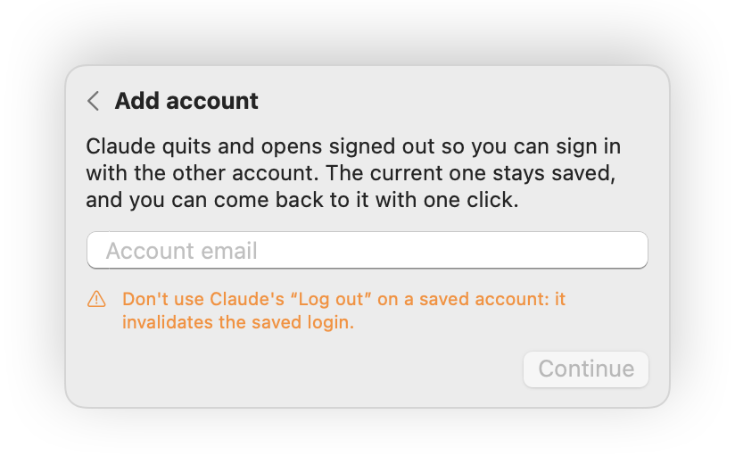
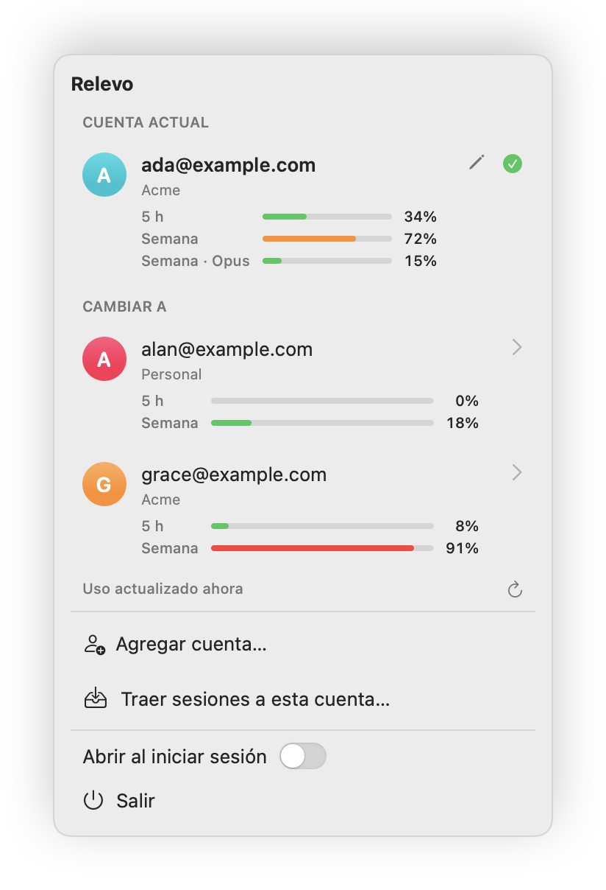

<p align="center">
  
</p>

<h1 align="center">Relevo</h1>

<p align="center">
  A menu bar app for Claude Desktop: switch between accounts, take your open
  sessions with you, and see at a glance which account still has room.
</p>

<p align="center">
  
  
  
</p>

<p align="center">
  <picture>
    <source media="(prefers-color-scheme: dark)" srcset="docs/screenshots/menu-en-dark.png">
    
  </picture>
</p>

> [!NOTE]
> An independent project, not affiliated with or endorsed by Anthropic. It works
> by reading Claude Desktop's local files, which are undocumented and can change
> with any Desktop update.

## Why

Claude Desktop holds one login at a time. If you use a work and a personal
account, switching means logging out, logging back in, and losing sight of the
Code sessions you had open, because Desktop files them under the account that
created them.

Relevo keeps a saved login per account and swaps them for you: one click, no
sign-in, and your open sessions come along. The name is Spanish for the
handover between shifts, which is what it does with your work.

## Features

- **One-click switching.** Claude quits, the other account's login goes in,
  and Claude opens on it. No password, no browser round trip.
- **Sessions follow you.** When you switch, the open Code sessions of the
  account you're leaving are ticked to come along. Untick any you want to leave
  behind, or pick sessions from other accounts too.
- **Usage at a glance.** Every account shows its 5-hour and weekly windows,
  plus the busiest per-model weekly limit, in green, orange or red. Hover a bar
  to see when it resets.
- **Add accounts in place.** It saves the current login and opens Claude signed
  out; you sign in with the other account once, and from then on it's a click.
- **English and Spanish**, following the system language.

<table>
  <tr>
    <td align="center" width="50%">
      <picture>
        <source media="(prefers-color-scheme: dark)" srcset="docs/screenshots/switch-en-dark.png">
        
      </picture>
      <br><sub>Pick the sessions to take along</sub>
    </td>
    <td align="center" width="50%">
      <picture>
        <source media="(prefers-color-scheme: dark)" srcset="docs/screenshots/add-en-dark.png">
        
      </picture>
      <br><sub>Add an account</sub>
      <br><br>
      <picture>
        <source media="(prefers-color-scheme: dark)" srcset="docs/screenshots/menu-es-dark.png">
        
      </picture>
      <br><sub>En español</sub>
    </td>
  </tr>
</table>

## Install

You need macOS 14 or later, Xcode with Swift 6, and Claude Desktop.

```bash
git clone https://github.com/Nico-Sanchez/relevo.git
cd relevo
scripts/build-app --install
```

That builds the app, copies it to `~/Applications` and opens it. It lives in
the menu bar; turn on **Open at login** from its menu to keep it there.

## Using it

1. **Add your second account.** With Claude signed in to your first account,
   choose **Add account…** and type the other account's email. Claude reopens
   signed out; sign in with that account.
2. **Switch.** Open the menu and click the account you want. Untick any
   sessions you'd rather leave where they are, then **Switch**.
3. **See usage.** The first time you open the menu, macOS asks whether Relevo
   may use the `Claude Safe Storage` keychain item. Allow it to see each
   account's usage; everything else works without it.

> [!WARNING]
> Never use Claude's own **Log out** on an account you want to keep. It ends the
> session on Anthropic's side, and the saved login stops working. If it happens,
> sign in again; the next switch saves the new login.

## How it works

Claude Desktop keeps its data in `~/Library/Application Support/Claude`.

- **Login.** It's the `Cookies` database (the claude.ai `sessionKey` cookie)
  plus four keys in `config.json`: `oauth:tokenCache`, `oauth:tokenCacheV2`,
  `lastKnownAccountUuid` and `bootSideSessions`. A switch saves them for the
  current account in
  `~/Library/Application Support/Relevo/profiles/<account>/` and puts
  the target account's back. The state from before the last switch is kept in
  `backup/`.
- **Sessions.** Each Code session is a `local_*.json` file under
  `claude-code-sessions/<account>/<org>/`; moving the file moves the session.
  Transcripts live in `~/.claude/projects`, shared by every account. Archived
  sessions are never moved.
- **Current account.** It comes from the last
  `[LocalSessionManager] Initialization succeeded` line in
  `~/Library/Logs/Claude/main*.log`.
- **Usage.** It comes from `https://claude.ai/api/organizations/<org>/usage`,
  called with each account's `sessionKey`. Chromium encrypts that cookie with a
  key derived from the `Claude Safe Storage` keychain item, which is why macOS
  asks for permission.

Every change happens with Claude closed, and reading usage never changes
anything.

## Privacy

- The only network calls are the usage requests to claude.ai, one per account,
  at most once a minute while the menu is open.
- Saved logins stay on your Mac, in a folder only your user can read. The
  keychain key and the decrypted cookies are only held in memory.
- No analytics, no telemetry, no update checks.

## Limitations

- Undocumented internals: a Claude Desktop update can break switching, usage or
  both.
- A saved login expires like any other (about a month); Claude then asks you to
  sign in, and the next switch saves the new login.
- Sidebar pins and groups may not follow a moved session.
- The app is built locally and signed ad hoc; there's no notarized download yet.

## Localization

The English text in the code is the key. Translations live in
`Resources/Localization/<language>.lproj/Localizable.strings`, and
`InfoPlist.strings` there localizes the app's name. To add a language, add a
folder and run `scripts/check-localizations`, which lists the keys that
language is missing or no longer uses.

## Development

```bash
swift test                   # core tests
scripts/check-localizations  # every language has every key
scripts/build-app            # build/Relevo.app
scripts/build-app --install  # copy to ~/Applications and open it
scripts/make-screenshots     # regenerate docs/screenshots from demo data
scripts/make-icon            # regenerate the app icon
```

- `Sources/RelevoCore`: everything that touches Claude's files, the
  keychain and claude.ai. No UI and no user-facing text.
- `Sources/RelevoUI`: the SwiftUI menu and its model.
- `Sources/Relevo`: the app entry point.
- `Sources/Screenshots`: renders the menu against made-up accounts for this
  README.

---

Claude is a trademark of Anthropic, PBC.
