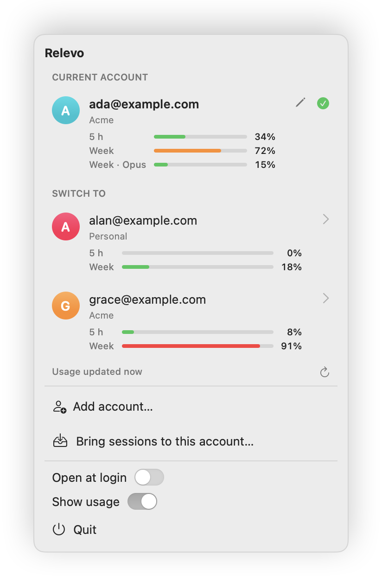
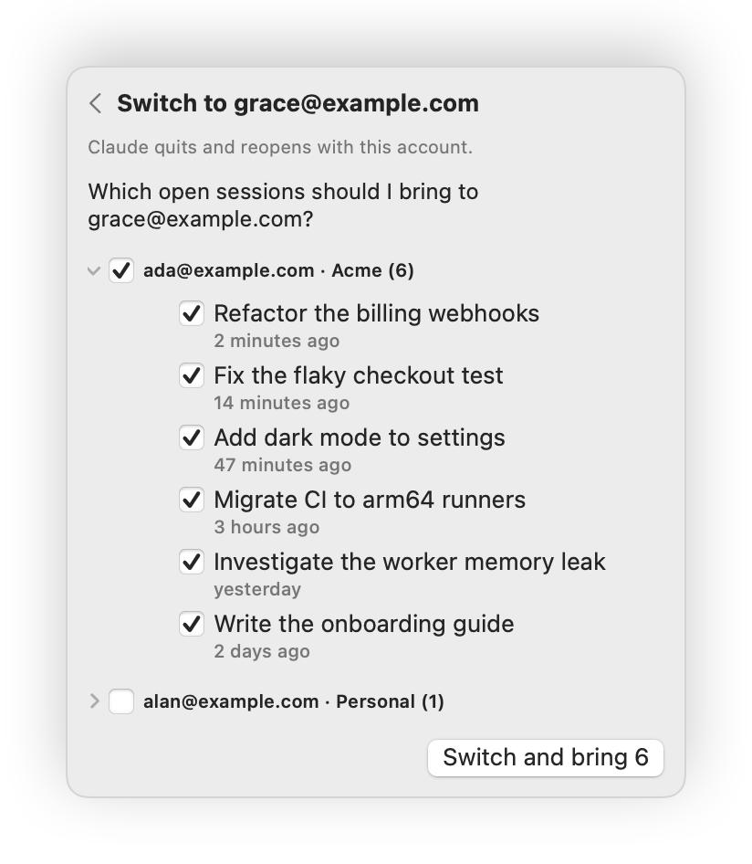
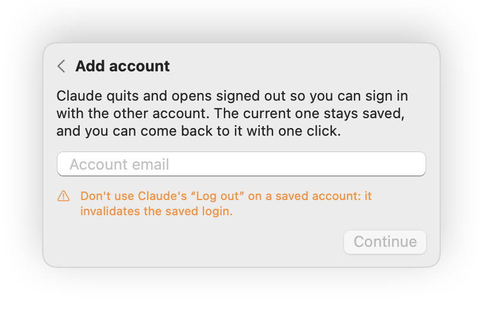
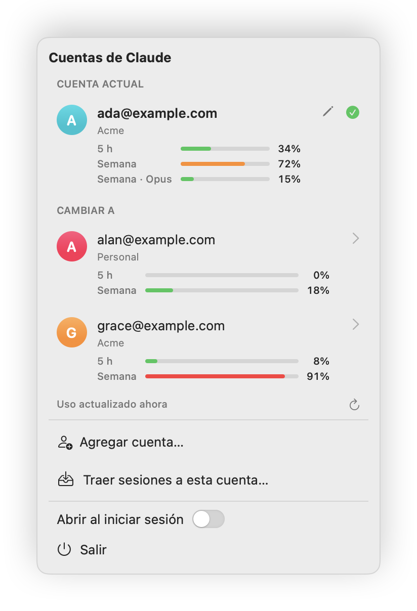

<p align="center">
  
</p>

<h1 align="center">Relevo</h1>

<p align="center">
  A menu bar app for Claude Desktop: switch between your accounts with one
  click and take your open sessions with you.
</p>

<p align="center">
  <a href="https://github.com/Nico-Sanchez/relevo/actions/workflows/ci.yml"></a>
  
  
  
  
</p>

<p align="center">
  <picture>
    <source media="(prefers-color-scheme: dark)" srcset="docs/screenshots/menu-en-dark.png">
    
  </picture>
</p>

> [!NOTE]
> An independent project, not affiliated with or endorsed by Anthropic. It works
> by reading Claude Desktop's local files, which are undocumented and can change
> with any Desktop update.

## Why

Claude Desktop holds one login at a time. If you use a work and a personal
account, switching means logging out, logging back in, and losing sight of the
Code sessions you had open, because Desktop files them under the account that
created them.

Relevo keeps a saved login per account and swaps them for you: one click, no
sign-in, and your open sessions come along. The name is Spanish for the
handover between shifts, which is what it does with your work.

## Features

- **One-click switching.** Claude quits, the other account's login goes in,
  and Claude opens on it. No password, no browser round trip.
- **Sessions follow you.** When you switch, the open Code sessions of the
  account you're leaving are ticked to come along. Untick any you want to leave
  behind, or pick sessions from other accounts too.
- **Optional usage display.** Off by default. When you turn it on, every
  account shows its 5-hour and weekly windows, plus the busiest other limit, in
  green, orange or red. Hover a bar to see when it resets.
- **Add accounts in place.** It saves the current login and opens Claude signed
  out; you sign in with the other account once, and from then on it's a click.
- **English and Spanish**, following the system language.

<table>
  <tr>
    <td align="center" width="50%">
      <picture>
        <source media="(prefers-color-scheme: dark)" srcset="docs/screenshots/switch-en-dark.png">
        
      </picture>
      <br><sub>Pick the sessions to take along</sub>
    </td>
    <td align="center" width="50%">
      <picture>
        <source media="(prefers-color-scheme: dark)" srcset="docs/screenshots/add-en-dark.png">
        
      </picture>
      <br><sub>Add an account</sub>
      <br><br>
      <picture>
        <source media="(prefers-color-scheme: dark)" srcset="docs/screenshots/menu-es-dark.png">
        
      </picture>
      <br><sub>En español</sub>
    </td>
  </tr>
</table>

## Install

### Download

1. Download **Relevo.zip** from the
   [latest release](https://github.com/Nico-Sanchez/relevo/releases/latest),
   unzip it and move **Relevo.app** to your Applications folder.
2. Open it. Relevo isn't notarized, so macOS blocks it the first time: open
   **System Settings › Privacy & Security**, scroll to the message about Relevo
   and click **Open Anyway**.

It runs on macOS 14 or later, on Apple silicon and Intel, and lives in the
menu bar; turn on **Open at login** from its menu to keep it there. Every
release is built by this repository's CI, and you can check that a download
came from it:

```bash
shasum -a 256 -c Relevo.zip.sha256
gh attestation verify Relevo.zip -R Nico-Sanchez/relevo
```

To update, replace the app with the new one. Because it isn't notarized, macOS
asks again for the keychain permission after each update if **Show usage** is
on.

### Build from source

You need Xcode with Swift 6.

```bash
git clone https://github.com/Nico-Sanchez/relevo.git
cd relevo
scripts/build-app --install
```

That builds the app, copies it to `~/Applications` and opens it.

## Using it

1. **Add your second account.** With Claude signed in to your first account,
   choose **Add account…** and type the other account's email. Claude reopens
   signed out; sign in with that account.
2. **Switch.** Open the menu and click the account you want. Untick any
   sessions you'd rather leave where they are, then **Switch**.
3. **Usage, if you want it.** Turn on **Show usage** in the menu. Relevo
   explains what it does, and macOS asks whether it may use the
   `Claude Safe Storage` keychain item. Read
   [About the usage display](#about-the-usage-display) first.

> [!WARNING]
> Never use Claude's own **Log out** on an account you want to keep. It ends the
> session on Anthropic's side, and the saved login stops working. If it happens,
> sign in again; the next switch saves the new login.

## About the usage display

Claude Desktop doesn't show how much of each account's limits you've used, so
Relevo asks claude.ai's private usage endpoint directly, with each account's
session. Anthropic's [Consumer Terms](https://www.anthropic.com/legal/consumer-terms)
don't allow accessing Claude through automated means except with an API key,
so this is off by default and turning it on is your call, at your own risk.

Switching accounts and moving sessions never contact Anthropic: they only move
Claude Desktop's own files on your Mac.

## How it works

Claude Desktop keeps its data in `~/Library/Application Support/Claude`.

- **Login.** It's the `Cookies` database (the claude.ai `sessionKey` cookie)
  plus four keys in `config.json`: `oauth:tokenCache`, `oauth:tokenCacheV2`,
  `lastKnownAccountUuid` and `bootSideSessions`. A switch saves them for the
  current account in
  `~/Library/Application Support/Relevo/profiles/<account>/` and puts
  the target account's back. The state from before the last switch is kept in
  `backup/`.
- **Sessions.** Each Code session is a `local_*.json` file under
  `claude-code-sessions/<account>/<org>/`; moving the file moves the session.
  Transcripts live in `~/.claude/projects`, shared by every account. Archived
  sessions are never moved.
- **Current account.** It comes from the last
  `[LocalSessionManager] Initialization succeeded` line in
  `~/Library/Logs/Claude/main*.log`.
- **Usage**, only with **Show usage** on. It comes from
  `https://claude.ai/api/organizations/<org>/usage`, called with each account's
  `sessionKey`. Chromium encrypts that cookie with a
  key derived from the `Claude Safe Storage` keychain item, which is why macOS
  asks for permission.

Every change happens with Claude closed, and reading usage never changes
anything.

## Driving Relevo Code from other tools

Relevo Code, built with `scripts/build-code-app`, runs Claude Code sessions in
several accounts at once, each with its own `CLAUDE_CONFIG_DIR`. Other local
tools, such as a board of your issues, can open sessions in it and read every
account's usage. The link and the file below are a contract: changing either
is a breaking change.

### Open a session: `relevo-code://new`

```text
relevo-code://new?account=<id>&folder=<absolute path>&prompt=<text>
```

| Parameter | Required | Value |
| --- | --- | --- |
| `account` | yes | An account's `id` from `code-accounts.json`: its `CLAUDE_CONFIG_DIR` path, or `~/.claude` for the standard account. |
| `folder` | yes | The absolute path of an existing folder. |
| `prompt` | no | Text put in the message box, not sent: the person reads it and presses Return. |

Percent-encode every value (`%20` for a space; `+` stays a literal plus). The
session starts like one from **New Session**: with the last permission mode
used, and in a new worktree when the folder is a git repository. An unknown
account or a folder that isn't there shows an error and starts nothing. The
link launches Relevo Code if it isn't running.

```bash
open "relevo-code://new?account=~/.claude&folder=%2FUsers%2Fana%2Fcode%2Fsite&prompt=Fix%20the%20header"
```

### Accounts and usage: `code-accounts.json`

Relevo Code keeps `~/Library/Application Support/Relevo/code-accounts.json`
up to date: it rewrites it when its accounts or their sign-in change, and on
every rate-limit event a session receives. Each write goes to a temporary file
that is then renamed over the old one, so a reader never sees half a file. It
makes no requests of its own: account details come from
`claude auth status --json`, and usage from the `rate_limit_event` messages
Claude Code already streams.

```json
{
  "updatedAt": "2026-11-26T15:42:35Z",
  "accounts": [
    {
      "id": "~/.claude",
      "configDir": null,
      "email": "ana@example.com",
      "organization": "Ana's Organization",
      "subscription": "pro",
      "usage": null
    },
    {
      "id": "/Users/ana/.claude-work",
      "configDir": "/Users/ana/.claude-work",
      "email": "ana@work.example",
      "organization": "Work",
      "subscription": "max",
      "usage": {
        "updatedAt": "2026-11-26T15:40:02Z",
        "windows": [
          { "label": "5-hour", "percentUsed": 8, "resetsAt": "2026-11-26T19:00:00Z" },
          { "label": "Weekly", "percentUsed": 62, "resetsAt": "2026-11-30T09:00:00Z" }
        ]
      }
    }
  ]
}
```

- Every key is always present; unknown values are `null`. Dates are ISO 8601
  in UTC.
- `id` is what `account=` takes. `configDir` is the absolute
  `CLAUDE_CONFIG_DIR`, or `null` for `~/.claude`.
- `email`, `organization` and `subscription` come from `claude auth status`,
  and are `null` while the account is signed out.
- `usage` is `null` until a session in that account receives a rate-limit
  event, then holds the latest one, kept across restarts. It is as fresh as the
  last message sent in that account from Relevo Code.
- `percentUsed` is a whole number and can pass 100. `resetsAt` can be `null`.
- `label` is `5-hour`, `Weekly`, or `Weekly · <name>` for a narrower weekly
  window such as `Weekly · Opus`. Any other window keeps Claude Code's own
  name for it.

## Privacy

- With **Show usage** off, the default, Relevo makes no network requests. With
  it on, the only requests go to claude.ai, one per account, at most once a
  minute while the menu is open.
- Saved logins stay on your Mac, in a folder only your user can read. The
  keychain key and the decrypted cookies are only held in memory.
- Relevo Code's `code-accounts.json` holds your accounts' emails and usage, and
  only your user can read it.
- No analytics, no telemetry, no update checks.
- Found a security problem? See [SECURITY.md](SECURITY.md).

## Limitations

- Undocumented internals: a Claude Desktop update can break switching, usage or
  both.
- A saved login expires like any other (about a month); Claude then asks you to
  sign in, and the next switch saves the new login.
- Sidebar pins and groups may not follow a moved session.
- Releases are signed ad hoc, not notarized, so macOS asks you to approve the
  first launch.

## Localization

The English text in the code is the key. Translations live in
`Resources/Localization/<language>.lproj/Localizable.strings`. To add a
language, add a folder and run `scripts/check-localizations`, which lists the keys that
language is missing or no longer uses.

## Development

```bash
swift test                     # core and model tests
scripts/check-localizations    # every language has every key
scripts/build-app              # build/Relevo.app
scripts/build-app --install    # copy to ~/Applications and open it
scripts/build-app --universal  # Apple silicon and Intel, like releases
scripts/make-screenshots       # regenerate docs/screenshots from demo data
scripts/make-icon              # regenerate the app icon
```

- `Sources/RelevoCore`: everything that touches Claude's files, the
  keychain and claude.ai. No UI and no user-facing text.
- `Sources/RelevoUI`: the SwiftUI menu and its model.
- `Sources/Relevo`: the app entry point.
- `Sources/Screenshots`: renders the menu against made-up accounts for this
  README.

Pushing a `v*` tag that matches `CFBundleShortVersionString` in
`Resources/Info.plist` makes the Release workflow build the universal app,
attest it and publish it with its SHA-256.

## License

[MIT](LICENSE)

---

Claude is a trademark of Anthropic, PBC.
